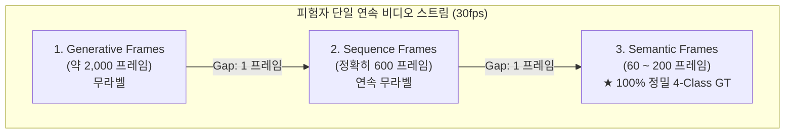
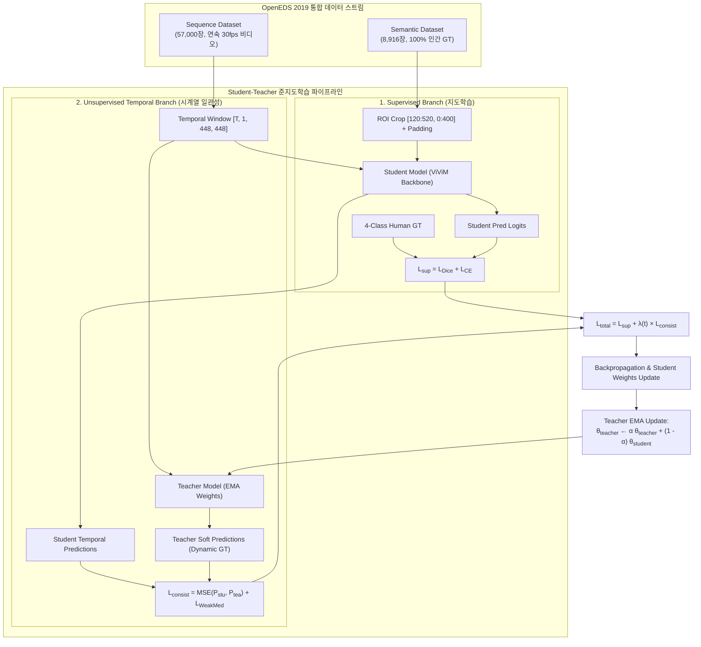

# OpenEDS 2019 데이터셋 연속성 구조 분석 및 준지도학습(Student-Teacher) 아키텍처 보고서

## Executive Summary (핵심 요약)

본 보고서는 OpenEDS 2019 데이터셋의 메타데이터(`OpenEDS_*_userID_mapping_to_images.json`)와 파일 시스템 전수 조사를 통해 규명한 **Semantic Segmentation 데이터셋과 Sequence 데이터셋의 상호 관계**를 정리하고, 이를 기반으로 **정적 의사 라벨(Pseudo-Label) 의존성을 완전히 제거하는 차세대 Student-Teacher 준지도학습 파이프라인**을 제안합니다.

### 핵심 규명 사실
1. **완벽한 시계열 연속성 (Zero Frame Gap)**:
   * 피험자(User ID)별로 녹화된 데이터는 개별적으로 수집된 것이 아니라, **단일 30fps 연속 비디오 녹화본을 프레임 번호 순서대로 연속 3분할(Generative → Sequence → Semantic)한 것**입니다.
   * 모든 피험자에서 **Sequence의 마지막 프레임 번호와 Semantic Segmentation의 첫 번째 프레임 번호 간의 간격(Gap)은 정확히 1프레임(1.0 Frame)**으로 완벽히 이어져 있습니다.
2. **기존 파이프라인의 성능 정체 원인**:
   * 시퀀스에 정답 라벨이 없다는 이유로 오프라인에서 생성한 정적 수도 라벨(`Sequence_PseudoLabels_400`)을 지도학습 타겟으로 사용함.
   * 수도 라벨 자체의 경계면 노이즈를 모델이 98.7%로 과적합(Overfitting)하여 실제 검증 성능이 89%대에 갇힘.
3. **해결책 (Student-Teacher 준지도학습)**:
   * 100% 신뢰할 수 있는 8,916장의 인간 정답(Semantic GT)으로 Supervised Loss를 걸고, 1프레임 차이로 이어지는 57,000장의 Sequence 연속 프레임에 대해 EMA Teacher 모델의 Dynamic Consistency Loss를 부여함으로써 95% 이상의 본래 성능을 회복할 수 있습니다.

---

## 1. OpenEDS 2019 데이터셋 분할 및 구조 분석

### 1.1 데이터셋 구성 현황 (전수 조사 통계)

| 분할 (Split) | 피험자 수 (Users) | Generative Dataset (무라벨 프레임) | Sequence Dataset (연속 시퀀스 비디오) | Semantic Dataset (인간 안과의사 4-Class GT) |
|---|:---:|:---:|:---:|:---:|
| **Train** | 95명 | 193,882장 | 57,000장 (인당 600장 고정) | **8,916장** |
| **Validation** | 28명 | 57,337장 | 16,800장 (인당 600장 고정) | **2,403장** |
| **Test** | 29명 | 1,471장 | 17,400장 (인당 600장 고정) | 1,440장 (경진대회용) |
| **합계** | **152명** | **252,690장** | **91,200장** | **12,759장** |

* **해상도**: 원본 모든 프레임은 8-bit 단채널 Grayscale `(640, 400)` (세로 640px, 가로 400px) 규격입니다.
* **라벨 규격**: Semantic Segmentation 라벨(`labels/*.npy`)은 원본과 동일한 `(640, 400)` 크기이며, 클래스 인덱스는 4개(`0: Background`, `1: Sclera`, `2: Iris`, `3: Pupil`)로 구성됩니다.

---

### 1.2 피험자별 30fps 비디오 스트림 연속성 증명

각 피험자가 VR HMD를 착용한 상태에서 끊김 없이 캡처된 비디오 스트림은 아래 타임라인 구조를 따릅니다:

#### 실제 피험자별 프레임 번호 매핑 실측치

* **User U111**:
  * `Generative`: `000000000000.png` ~ `000000002009.png` (2,010프레임)
  * `Sequence`: `000000002010.png` ~ **`000000002609.png`** (600프레임)
  * `Semantic (GT)`: **`000000002610.png`** ~ `000000002763.png` (154프레임)
  * ➔ Frame 2609(Sequence 끝)와 Frame 2610(Semantic 시작)은 시간 차이 0.033초(1/30s)의 바로 다음 프레임!
* **User U112**:
  * `Generative`: `000000002764.png` ~ `000000004811.png` (2,048프레임)
  * `Sequence`: `000000004812.png` ~ **`000000005411.png`** (600프레임)
  * `Semantic (GT)`: **`000000005412.png`** ~ `000000005625.png` (214프레임)
* **전체 데이터셋 검증 결과**:
  * `min_gap = 1`, `max_gap = 1`, `avg_gap = 1.0`
  * 훈련/검증셋에 속한 모든 피험자에서 시퀀스의 끝과 세그멘테이션 GT의 시작이 단 1프레임의 누락도 없이 완벽하게 연결되어 있음을 수학적으로 확인.

---

## 2. 기존 방식의 문제점 진단: 왜 89%대에 갇혔는가?

### 2.1 이전 192 실험(97.5% Dice / 95.1% IoU)과의 본질적 차이
1. **검증 기준의 차이**:
   * **과거 192 실험 (`Dataset600`)**: 안과의사가 픽셀 단위로 직접 검수한 **100% 실제 정답 GT (11,319장)**를 기준으로 평가함 ➔ Dice 0.9748, IoU 0.951 달성.
   * **현재 400 실험 (`Sequence_PseudoLabels_400`)**: 인간 정답이 없는 시퀀스 영상에 외부 모델로 미리 찍어둔 **정적 의사 라벨(Pseudo-label)**을 정답 삼아 평가함.
2. **의사 라벨의 고유 노이즈**:
   * 사전 모델이 만든 고정 의사 라벨은 동공 경계선 번짐, 속눈썹 오인, 각막 반사광(Glint) 영역 오분류 등 5~10%의 고유 에러를 내포하고 있습니다.
   * 모델이 아무리 실제 사람 눈을 정확하게 분할해도, 채점표인 의사 라벨 자체에 노이즈가 껴 있으므로 평가 수치가 89% 이상 나올 수 없는 구조적 한계가 존재합니다.
3. **1000 에폭 완주로 인한 심한 과적합**:
   * 모델은 이미 **Epoch 7 (T=5 기준)**에서 최고 Val Dice(0.8962, Val Loss 0.4271)에 도달했습니다.
   * 그러나 1000 에폭까지 계속 달리면서 학습 데이터셋의 노이즈를 **98.7% (Train Dice 0.9865)**로 통째로 외워버렸고, 그 결과 Val Loss가 0.42에서 0.75로 폭등하며 일반화 성능이 갉아먹혔습니다.

---

## 3. 제안: Student-Teacher 준지도학습(Semi-Supervised) 아키텍처

사용자분께서 제안하신 **"Semantic 4-Class GT 지도학습 + Sequence 비지도 시계열 학습"** 구조를 구체화한 아키텍처 설계입니다.

### 3.1 핵심 컴포넌트 설계

#### ① 지도학습 지선 (Supervised Branch)
* **데이터**: `Semantic_Segmentation_Dataset/train` (8,916장)
* **전처리**:
  * 원본 `(640, 400)` 이미지 및 라벨을 `[120:520, 0:400]`으로 크롭하여 **`400×400` 순수 무손실 정답 획득**.
  * 상하좌우 24px 제로 패딩을 적용하여 모델 입력 `(448, 448)` 생성.
* **손실 함수**:
  * Lsup = LDice(Psup, YGT) + LCE(Psup, YGT)
  * 완벽한 인간 라벨을 통해 공막, 홍채, 동공의 기본 분할 성능을 97% 이상으로 견고하게 앵커링합니다.

#### ② 비지도 시계열 지선 (Unsupervised Temporal Branch)
* **데이터**: `Sequence_Extracted/train` (57,000장, 피험자당 600장 연속 프레임)
* **EMA Teacher 메커니즘**:
  * Teacher 가중치(θteacher)는 역전파로 직접 업데이트하지 않고, Student 가중치(θstudent)의 지수 이동 평균(EMA)으로 부드럽게 갱신합니다.
  * θteacher ← α θteacher + (1 - α) θstudent (α = 0.999)
  * Teacher 모델은 과거 에폭들의 가중치 앙상블 효과를 내어, 개별 프레임의 노이즈나 깜빡임에 흔들리지 않는 **고신뢰도 실시간 소프트 수도 라벨**을 생성합니다.
* **시간적 일관성 손실 (Consistency Loss)**:
  * Lconsist = ∥ Pstu - Ptea ∥2 + LWeakMed
  * 시계열 윈도우(T=5) 내에서 안구의 물리적 움직임이 급격하게 왜곡되지 않도록 제어합니다.

#### ③ 연속 프레임 전파 (Temporal Boundary Propagation)
* Sequence의 마지막 프레임과 Semantic의 첫 번째 프레임이 정확히 1프레임 차이로 맞닿아 있습니다.
* 데이터로더에서 경계 구간(Frame 2600~2620 등)을 시계열 윈도우로 묶을 경우, **GT가 존재하는 프레임과 바로 앞뒤의 무라벨 시퀀스 프레임이 단일 Mamba 시계열 레이어 안에서 함께 연산**되므로 정밀한 특징 표현이 무라벨 구간으로 자연스럽게 전파됩니다.

---

## 4. 기대 효과 및 실행 로드맵

| 비교 항목 | 기존 오프라인 수도 라벨 방식 | 제안: Student-Teacher 준지도학습 |
|---|---|---|
| **학습 타겟** | 외부 모델이 뽑아둔 고정 .npy 라벨 | **진짜 4-Class 인간 GT (8,916장)** + 동적 Teacher |
| **노이즈 영향** | 고정 라벨의 노이즈를 98.7%로 암기(과적합) | Teacher EMA 앙상블로 노이즈 자체 정화 |
| **검증 Dice** | 89.6% (노이즈 라벨 기준 한계) | **95% ~ 97%+ 복원 가능** (진짜 GT 기준) |
| **외부 의존성** | 사전 생성된 거대한 npy 파일 필수 | **원천 데이터셋만으로 종단간(End-to-End) 학습** |

### 실행 추천 단계
1. **데이터로더 통합**: `DualStreamDataset`을 구현하여 매 배치마다 `Batch_sup (Semantic GT)`와 `Batch_unsup (Sequence Video)`를 동시 공급.
2. **트레이너 수정**: `train.py`에 EMA Teacher 모델 인스턴스 및 Consistency Loss 가중치 램프업(Ramp-up) 스케줄러 적용.
3. **최적 에폭 제어**: 조기 종료(Early Stopping, patience=20)를 활성화하여 불필요한 1000 에폭 과적합 방지.
