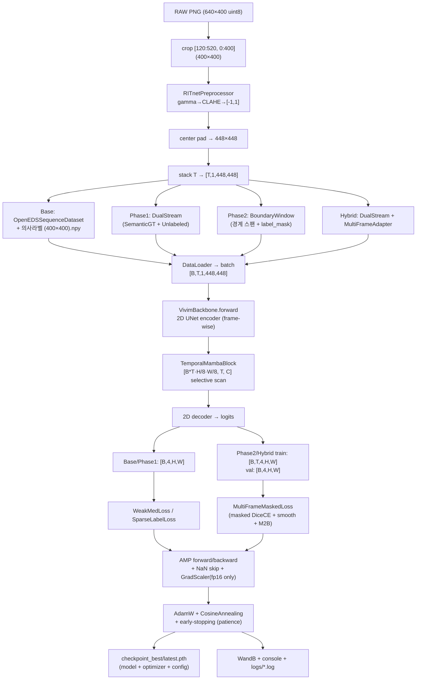

# ViViM + Mamba3 학습 코드 리뷰 (데이터 플로우 중심)

> **리뷰 대상**: OpenEDS 2019 시퀀스 세그멘테이션 학습 파이프라인 (`train.py` / `train_phase1.py` / `train_phase2.py` / `train_phase1_2.py` + `datasets/` · `models/` · `losses/` · `utils/`)
> **리뷰 기준**: `.agents/skills/research-code-harness/SKILL.md` (연구 코드 생성 하네스)
> **날짜**: 2026-09-15
> **환경**: Python 3.10 · torch 2.5.1+cu118 · mamba-ssm 2.3.2.post1 · CUDA

---

## 0. TL;DR

| 구분 | 평가 |
|------|------|
| 데이터 → 모델 → 손실 → 트레이너 단방향 모듈화 | ✅ 대체 준수 (datasets/models/losses 분리, 인라인 클래스 없음) |
| Config/코드 분리 | ⚠️ 부분 위반 — 리터럴 크롭·전처리 파라미터, 하드코딩된 로그명·절대 경로가 코드에 잔존 |
| Ablation 스위치 | ⚠️ 일부만 작동 — `mamba_version`, `mamba_headdim`, `min_epochs` 등 설정 키가 코드로 흐르지 않음 (dead knob) |
| 재현성 | ✅ 시드 고정 + config 스냅샷 + checkpoint 내 config 메타데이터 저장 |
| **데이터 플로우 정확성** | 🔴 **`openeds_dataset.py` 미커밋 변경에서 fallback 이미지 크기가 (400,640)으로 반전** / 🟠 **192 경로는 (640,400)→(192,192) 비정방 비율(0.625→1.0) 왜질로 학습** |

> 이 리뷰는 "데이터가 파일시스템 → 텐서 → logits → loss → checkpoint로 흘러가는 경로"를 단계별로 추적하면서, 각 전환점에서 값이 어떻게 변하는지와 그 경로에 존재하는 버그/취약을 짚는다.

---

## 1. 데이터 플로우 개요 (엔드투엔드)

### 1.1 원본 데이터 구조 (OpenEDS 2019)

- 원본 프레임: 8bit grayscale, shape **`(H=640, W=400)`** — 세로 640, 가로 400.
- `Semantic_Segmentation_Dataset/{train,validation}/{images/*.png, labels/*.npy}`: **인간 GT** (`.npy` shape `(640,400)`, 클래스 0~3).
- `Sequence_Extracted/{train,validation}/*.png`: 라벨 없는 연속 시퀀스 (train 57,000장).
- `Sequence_PseudoLabels_400/{train,validation}/*.npy`: 시퀀스에 대한 **정적 의사 라벨** (shape `(400,400)`, 이미 크롭·정규화 공간).

시퀀스·시맨틱이 피험자별로 1프레임 간격으로 연속 이어지는 구조이므로, Phase 1~2는 이 연속성을 활용해 라벨 없는 시퀀스 프레임과 GT 프레임 같은 윈도우에 섞는 것을 전제로 한다.

### 1.2 전처리 파이프라인 (모든 phase 공통)

```
RAW PNG (H=640, W=400, uint8)
   │
   ▼ crop  img[y0:y1, x0:x1]        # y0,y1,x0,x1 = cfg.data.input_crop = (120, 520, 0, 400)
   │                            # → (400, 400)
   ▼ RITnetPreprocessor            # gamma(0.8) → CLAHE(1.5, 8×8) → /255 → (x-0.5)/0.5 ∈ [-1,1]
   │                            # → (400, 400) float32
   ▼ pad (center)                  # cfg.data.target_resolution = (448,448), 48px 각 방향
   │                            # → (448, 448)
   ▼ stack (T프레임)               # → [T, 1, 448, 448]
   ▼ (라벨도 동일 pad)             # → label [448,448] / [T,448,448]
   ▼ to tensor                     # images: float32, label(s): int64/bool
```

> **핵심 불일치**: 위 크롭/정규화 값은 YAML의 `data.input_crop`, `data.target_resolution`로 주입된다. 그러나 `RITnetPreprocessor`의 **gamma/CLAHE/normalization 상수는 config가 아니라 클래스 기본 인자(리터럴)로 하드코딩**되어 있다 (하네스 규칙 1 위반, §4 P2 `RITnetPreprocessor` 중복 항목).

### 1.3 4가지 학습 경로 (phase별 배치 키)

| Phase | 스크립트 | 데이터셋 | 배치 키 | 모델 출력 | 손실 |
|-------|---------|---------|---------|-----------|------|
| Base | `train.py` | `OpenEDS400/192 SequenceDataset` (의사라벨) | `images, label` | `[B,4,448,448]` | `WeakMedLoss` |
| Phase 1 (A) | `train_phase1.py` | `DualStream` (GT+무라벨 혼합) | `images, label, has_label` | `[B,4,448,448]` | `SparseLabelLoss` |
| Phase 2 (D) | `train_phase2.py` | `BoundaryWindow` (경계 스팬) | `images, labels, label_mask` | `[B,T,4,448,448]` (train) / `[B,4,448,448]` (val) | `MultiFrameMaskedLoss` |
| Hybrid (E) | `train_phase1_2.py` | `DualStream`→`MultiFrameAdapter` | `images, labels, label_mask` | `[B,T,4,448,448]` (train) / `[B,4,448,448]` (val) | `MultiFrameMaskedLoss` |

### 1.4 데이터 플로우 다이어그램



### 1.5 모델 내부 데이터 플로우 (`VivimBackbone` / `VivimBackboneMultiFrame`)

```
x: [B, T, 1, 448, 448]
  │ view → [B*T, 1, 448, 448]           (프레임 단위 2D 인코딩)
  ├─ enc1/pool1 → e1 [B*T,32,448,448]
  ├─ enc2/pool2 → e2 [B*T,64,224,224]
  ├─ enc3/pool3 → e3 [B*T,128,112,112]
  └─ bottleneck → b  [B*T,256,56,56]
       │ view → [B,T,256,56,56]
       ▼ TemporalMambaBlock
       │   permute → [B·56·56, T, 256]   (공간 위치별 시간 시퀀스로 flatten)
       │   LayerNorm → MambaLayer(Mamba3) → Linear + residual
       │   reshape → [B,T,256,56,56]
       ▼
       │ Base: b_last = b_mamba[:, -1]   (마지막 프레임 병목만)
       │ MultiFrame: b_mamba 전체 (T프레임)
       ▼
  decoder (skip = 마지막 프레임 e1/e2/e3 또는 t프레임별)
       │ _decode_single_frame: up3/dec3 → up2/dec2 → up1/dec1 → final_cls(1×1)
       ▼
  Base:            [B,4,448,448]
  MultiFrame train: [B,T,4,448,448]   (torch.utils.checkpoint 로 T프레임별 디코드)
  MultiFrame val:   [B,4,448,448]     (마지막 프레임만 — 추론과 동일, zero overhead)
```

---

## 2. 잘 된 부분

1. **단방향 모듈화가 실제로 지켜진다.** `datasets/`는 모델·Loss를 import하지 않고, `models/`는 순수 `forward()`만, `losses/`는 독립 클래스. `train*.py`에 인라인 `class` 선언이 없다 (하네스 규칙 2 준수).
2. **재현성 인프라 완비.** `utils/seed.py`가 `random/np/torch/cudnn(deterministic, no-benchmark)`을 함께 고정하고, `main()` 진입 시 `config_snapshot.yaml`을 저장하며, `checkpoint_best.pth`에 `config` 전체를 함께 저장한다 (하네스 규칙 4 준수).
3. **MultiFrame의 train/inference 비대칭 설계가 정석적.** 학습 시 T프레임 전부 디코딩(그래드 체크포인팅), 추론/검증 시 마지막 프레임만 디코딩 → 배포 시 zero overhead. `VivimBackboneMultiFrame.forward(output_all_frames=...)`가 이걸 깔끔하게 분기한다.
4. **희소 라벨 손실이 의사라벨을 쓰지 않는다** (Strategy A). 무라벨 시퀀스에 EMA teacher 대신 경계 선명도(M2B) self-supervision만 부여해 자기강화 발산을 방지하는 의도가 코드에 명확히 반영돼 있다.
5. **loss/NaN 방어 + 정밀도 분기.** Phase 1~3에서 NaN/Inf loss 발생 시 그 스텝만 스킵하고, `fp16`일 때만 `GradScaler`를 활성화 (bf16은 scaler 불필요)하는 분기가 정확하다.
6. **환경 호환 패치가 실제로 필요하다.** torch 2.5.1 + mamba-ssm 2.3.2(post1) 조합에서 `mamba_ssm` import 자체가 `torch.float8_e8m0fnu` 부재로 **즉시 AttributeError**를 유발함을 직접 재현 확인했다. `train*.py` 상단의 compat patch가 없으면 학습이 아예 시작되지 않으므로, 이 패치는 옵션이 아니라 **필수 전제**다.

---

## 3. 데이터 플로우 단계별 추적

각 전환점에서 텐서 shape/dtype이 어떻게 변하는지, 그리고 그 경로에서 발견한 문제를 정리한다.

### Step 0 — 로딩 (`datasets/*.py`)

| 전환 | Base | Phase 1 | Phase 2 | Hybrid |
|------|------|---------|---------|--------|
| raw | `(640,400)` uint8 | `(640,400)` uint8 | `(640,400)` uint8 | `(640,400)` uint8 |
| crop | `img[120:520, 0:400]` → `(400,400)` | idem | idem | idem |
| prep | gamma/CLAHE/[-1,1] | idem | idem | idem |
| pad | `448×448` | `448×448` | `448×448` | `448×448` |
| stack | `[T,1,448,448]` | `[T,1,448,448]` | `[T,1,448,448]` | `[T,1,448,448]` |
| label | `label` `[448,448]` int64 | `label` `[448,448]` + `has_label` bool | `labels` `[T,448,448]` + `label_mask` `[T]` bool | `labels` `[T,448,448]` + `label_mask` `[T]` bool |

- `has_label`는 `default_collate`로 `torch.bool` 텐서가 됨을 직접 확인 (라벨/무라벨 혼합 배치에서도 `.any()`·`.bool()` 연산 정상).
- **Phase 2/Hybrid는 `label_mask`(bool)로 라벨 있는 프레임만 골라서 Dice를 계산**하므로, 무라벨 프레임의 0-fill 라벨이 지표에 오염되지 않는다. ✅

### Step 1 — 인코딩 (프레임 병렬 2D)

`x.view(B*T, C, H, W)`로 프레임을 배치축에 병합해 Conv/BN을 frame-wise 실행. Mamba3의 SSM은 공간 축이 아니라 **시간 축**을 스캔하므로, bottleneck에서 `view(B,T,C,Hb,Wb)` → `permute(0,3,4,1,2).reshape(B*Hb*Wb, T, C)`로 "각 공간 위치의 시간 시퀀스"를 만들어 선형 시간 복잡도로 스캔. 설계가 일관된다.

### Step 2 — 디코딩 & 출력

- Base/Phase1: `[:, -1]`로 마지막 프레임만 디코드 → `[B,4,448,448]`.
- MultiFrame: `output_all_frames=True`이면 T프레임 전부 디코딩 (체크포인팅), `False`이면 마지막 프레임만 → 추론 경로와 bit-identical.

### Step 3 — Loss (masked)

`MultiFrameMaskedLoss.forward`:
- `logits[mask]`로 `label_mask==1` 프레임만 골라 DiceCE (supervise).
- `softmax(logits)`의 인접 프레임 차의 L2 (temporal smooth).
- `MaxPool2d(5)-probs`의 절댓값 (M2B boundary, 전부 프레임).
- `rampup = min(1, epoch/rampup_ep)`로 비지도 항을 서서히 승격.

### Step 4 — 백프롭 & 최적화

- `torch.amp.autocast('cuda', dtype=amp_dtype)`, `GradScaler`는 `fp16`만.
- `max_grad_norm` (cfg) 기반 클리핑 — Phase 2/Hybrid는 scaler 경로에서도 `unscale_` 후 클리핑을 정확히 수행. ✅
- NaN/Inf 스킵 → `optimizer.zero_grad()` 후 해당 스텝만 통과.

### Step 5 — 체크포인트/로그

- `checkpoint_best.pth`: `model_state_dict`, `optimizer_state_dict`, `val_dice`, `val_metrics`, `config`. ✅ (하네스 규칙 4)
- `checkpoint_latest.pth`: 50/Base, 5/Phase 에폭마다.
- 로그: console + WandB + `logs/phase*.log`.

---

## 4. 데이터 플로우에서의 버그 및 위험 (우선순위 순)

### 🔴 P0 — `openeds_dataset.py` 미커밋 변경: fallback 이미지 크기 반전

`datasets/openeds_dataset.py` (현재 WIP, git status ` M`)에서 `OpenEDS400SequenceDataset.__getitem__`의 `cv2.imread` 실패 fallback이 **`(400,640)`**으로 잘못 쓰였다:

```python
img = cv2.imread(fpath, cv2.IMREAD_GRAYSCALE)
if img is None:
    img = np.zeros((400, 640), dtype=np.uint8)   # ← 반전 (원본은 H=640, W=400)
img_crop = img[y_start:y_end, x_start:x_end]      # img[120:520, 0:400]
```

원본 프레임은 `(H=640, W=400)`. `img[120:520, 0:400]`은 `(y1-y0=400, x1-x0=400)` = `400×400`를 기대하지만, `(400,640)` 배열에서는 `img[120:520, :400]`이 `y∈[120,520)` → **320행**만 남아 `(320, 400)`이 된다. 이후 `RITnetPreprocessor`는 target_size가 안 맞아 `cv2.resize(400×400)`로 320×400을 강제 리사이즈해 **수직 압축된 깨진 프레임**을 학습에 투입한다.

- **트리거 조건**: 이미지 파일이 누락/해결되지 않을 때만 발동. 정상 파일은 영향을 안 받지만, 누락 파일이 섞인 디렉터리(예: 부분 복사, mount 불안정)에서는 **조용히 오염된 프레임으로 학습**되어 디버깅이 매우 어렵다.
- **참고**: 같은 fallback 로직은 `dual_stream_dataset.py`·`boundary_window_dataset.py`에서 정석인 `(640,400)`을 쓰고 있다. **`openeds_dataset.py`만 (400,640)으로 반전**된 것이므로, 이 WIP 커밋 시점에 반드시 수정해야 한다.

> **수정**: `img = np.zeros((640, 400), dtype=np.uint8)` (또는 fallback을 아예 skip/raise로 바꾸는 것이 더 안전).

### 🟡 P2 — `train.py` 미커밋 변경: pretrained 로딩 블록 주석 인덴트 불일치 (가독성)

`train.py`에 추가된 pretrained 로드 블록의 주석이 **본문과 다른 들여쓰기**를 가진다 (git status ` M train.py`, L206-207):

```python
        # Load Pretrained Checkpoint if specified (Fine-tuning)
    pretrained_path = getattr(cfg.training, 'pretrained_checkpoint', None)
    if pretrained_path and os.path.isfile(pretrained_path):
        ...
```

주석 줄이 8스페이스, 본문이 4스페이스다. `python -m py_compile train.py`는 통과한다(주석은 인덴트 판정 대상이 아님) — **실행 오류가 아니라 정렬 위생 문제**. `main()` 본문(4스페이스) 속 코드임에도 주석만 8스페이스라 "별도 블록인가"로 오독될 수 있다. 주석 줄을 4스페이스로 정렬하면 해결된다.

> **검증**: 2026-09-15 기준 `nnunet_env`에서 `py_compile` 통과 확인(실행 가능). P0에서 P2로 재분류.

### 🟠 P1 — 192 경로: 원본 비정방 비율이 정방으로 왜질 (`OpenEDS192SequenceDataset`)

원본 프레임은 `(H=640, W=400)` (비율 0.625)인데, `OpenEDS192SequenceDataset`은 **크롭 없이 전체 프레임을** `RITnetPreprocessor(target_size=(192,192))`에 그대로 넘긴다. `cv2.resize`가 `INTER_LINEAR`로 `(192,192)` 정방으로 강제 리사이즈해 **가로가 ~1.6배 늘어난 왜질된 영상**이 학습된다.

```
(640,400)  →  cv2.resize → (192,192)   # 0.625 → 1.0, 가로 신축
```

- 400 경로는 `img[120:520, 0:400]`으로 **정방 400×400 크롭**을 먼저 해 비율을 보존하는 반면, 192 경로는 크롭 없이 리사이즈만 한다. 두 경로의 전처리 계약이 불일치한다.
- 직접 재현 확인: `RITnetPreprocessor()(random(640,400))` → 출력 `(192,192)`, 입력 비율 0.625 → 출력 1.0.
- **영향**: 192 실험(`vivim_mamba3_192`)의 세그멘테이션 경계가 원본 기하학과 비례하지 않을 수 있다. `docs/`의 과거 "192 97.5% Dice" 결과도 동일한 왜질 전처리 위에서 나온 것이므로, 192 vs 400 비교 시 이 비율 왜질이 교란 요인이다.
- **수정**: 192 경로도 원본에 정방 크롭(예: 눈 중앙 400×400)을 적용 후 리사이즈하거나, letterbox(패딩)으로 비율을 보존. 전처리 계약은 config(`preprocessing`)에서 명시.

### 🟠 P1 — `mamba_version` / `mamba_headdim` 설정이 모델로 흐르지 않음 (dead knob)

- `VivimBackbone.__init__`는 `mamba_version`, `mamba_headdim`을 **인자로 받지만 저장도·사용도 하지 않는다** (grep으로 `self.mamba_version` 저장 없음 확인). `temporal_mamba = TemporalMambaBlock(channels, d_state, d_conv, expand)`만 만들고 **`headdim`을 전달하지 않는다**.
- `TemporalMambaBlock.__init__`도 `headdim` 인자를 받지 않고, 내부 `MambaLayer(d_model, d_state, d_conv, expand)` 생성 시 `headdim`을 생략 → `MambaLayer` 기본값 64가 항상 쓰인다.
- 결과: YAML의 `model.mamba.headdim`과 `ablation.mamba_version`은 **아무런 효과를 내지 못한다**. `cfg.model.mamba.headdim`을 바꿔도 아키텍처가 변하지 않아, 실험 재현/어블레이션에 치명적이다 (하네스 규칙 1·3 위반).

> **수정**: `TemporalMambaBlock.__init__(..., headdim=...)`를 추가하고 `MambaLayer(..., headdim=headdim)`로 전달, `VivimBackbone`이 `mamba_headdim`을 `TemporalMambaBlock`에 넘기도록. `mamba_version`도 실제로 Mamba1/2/3/fallback을 분기하도록 구현하거나, 미지원이면 명시적 raise.

### 🟠 P1 — `min_epochs` early-stopping 설정이 읽히지 않음

`configs/*.yaml`의 `training.early_stopping.min_epochs`는 **어디서도 읽지 않는다** (grep 확인). `main()`은 `patience`만 사용한다. 설정에 `min_epochs: 50`을 넣어도 최소 학습이 보장되지 않는다 — 재현성에 영향을 준다.

### 🟠 P1 — `DualStreamBatchSampler`의 epoch 길이 불일치

- `__len__`은 `self.n_unlabeled // max(1, self.n_unlab)`을 반환한다. 그러나 `train_one_epoch`는 `min(len(dataloader), max_iters)`로 `num_iterations_per_epoch`(250)까지 반복하려 한다.
- unlabeled 샘플 수가 `n_unlab`의 배수가 아니거나 `n_batches < 250`이면, **실제 반복 수가 250보다 적어져 epoch이 조용히 짧아진다** (train/val 불균형, lr 스텝 수 감소). `get_dual_stream_dataloaders`에서 샘플 수와 250이 맞는지 검증 로직이 없다.
- 라벨 사이클링 `lab_cycle = (lab_idx * (... + 2))`가 `len(lab_idx)`가 0/1일 때의 경계 동작이 취약하다.

### 🟠 P1 — `get_openeds_sequence_dataloaders`의 데이터셋 분기 허크

```python
if '400' in str(pseudo_root) or getattr(cfg.data, 'dataset', '') == 'openeds_400':
    ds = OpenEDS400SequenceDataset(...)
else:
    ds = OpenEDS192SequenceDataset(...)
```

`'400' in str(pseudo_root)`는 **경로 문자열에 '400'이 포함되어 있으면** 400 데타셋을 쓰는 허크다. `Sequence_PseudoLabels_192`를 쓰는데 경로에 `400`이 들어 있으면(예: `.../nnUNet_400/...`) 오분기가 가능하다. `cfg.data.dataset` 플래그만으로 분기하는 것이 안전하다 (하네스 규칙 1).

### 🟡 P2 — `train.py`의 AMP API 비일관

- `train.py`는 `torch.cuda.amp.autocast(enabled=...)`와 `torch.cuda.amp.GradScaler`를 사용 (Phase 1~3은 `torch.amp.autocast('cuda', ...)`). 동작은 동일하지만, 하네스 규칙 5에서 요구하는 **최신 API 표준 `torch.amp.autocast`**으로 통일해야 한다. `train.py`가 Base 경로이므로 일관성을 위해 수정 권장.

### 🟡 P2 — `torch.load`의 `weights_only` 미지정

모든 `train*.py`의 `torch.load(..., map_location='cpu')`는 `weights_only`를 지정하지 않는다. torch 2.6+에서 기본값이 `weights_only=True`로 바뀌면 **`config`(ConfigDict)를 함께 저장한 checkpoint를 로드할 때 unpickler 에러**가 날 수 있다. checkpoint가 optimizer·config를 함께 담으므로, 의도적으로 `weights_only=False`를 명시하거나 상태만 저장하도록 분리하는 것이 안전하다.

### 🟡 P2 — 하드코딩된 로그 파일명 + `t5` 고정

- `train_phase1.py`: `with open("logs/phase1_sparse_t5.log", "a")` — **경로·이름이 코드 리터럴**. config의 `experiment.name`과 무관하게 `t5` 로그에만 쓰인다 (하네스 규칙 1·5 위반). `phase1_sparse_t3/t7` 실험을 돌리면 전부 이 파일에 섞여 쌓인다.
- `train_phase2.py`/`train_phase1_2.py`: `log_file = "logs/phase2_multiframe_t5.log"` 등 동일 문제.
- **수정**: `output_dir` 아래 `training.log`로 `exp_name`+`timestamp`을 담아 config 기반 경로로 유도.

### 🟡 P2 — 하드코딩된 절대 경로

- `configs/*.yaml`의 `data.semantic_gt_root`/`sequence_root`/`pretrained_checkpoint`가 `/home/iulab1/...` 또는 `/home/iulab0/...`로 하드코딩 (iulab0/iulab1 혼재).
- `nnUNetTrainer_Vivim_400.py`, `agent/test_smoke_phases.py`, `run_host_*.sh`에도 `/home/iulab0/PycharmProjects/nnUNet` 절대 경로가 다수.
- **수정**: `DATA_ROOT` 환경 변수 또는 config 루트 키에서 파생 (`os.path.expandvars`).

### 🟡 P2 — compat patch의 취약성 + 미커버

- `torch.float8_e8m0fnu = None` / `float4_e2m1fn_x2 = None`를 전역으로 monkeypatch하는 방식은 quack/mamba3가 실제 그 dtype을 연산에 쓰면 **실행 중 TypeError/CUDA error**로 이어질 수 있다. 현재는 import 단계에서 map에 `None`만 들어가게 해 우회하는 것으로, **mamba3 forward가 해당 dtype을 실제로 참조하는지 검증되지 않았다**.
- 이 patch가 `train*.py`·`diagnose_overflow.py`·`agent/test_smoke_phases.py`·`nnUNetTrainer_Vivim_400.py`에 **4곳 이상으로 중복**되어 있다. `utils/`로 단일 유틸(`utils/compat.py`)로 추출해 한 번만 적용해야 한다.
- **검증 공백**: Mamba3 forward가 실제로 이 patched dtype을 쓰는지 확인하는 단위 테스트가 없다.

### 🟡 P2 — `RITnetPreprocessor` 3중 중복 + config 미반영

- `openeds_dataset.py`(타입힌) / `dual_stream_dataset.py`(400) / `boundary_window_dataset.py`(400)에 **같은 전처리 클래스가 3번 정의**되어 있다.
- 그 파라미터(gamma=0.8, clahe_clip_limit=1.5, tile_grid=(8,8), normalize 0.5/0.5)는 **config의 `data.gamma`·`clahe_*`·`normalize_*` 키가 아닌 클래스 기본 인자**다. YAML에 이 값들이 있어도 코드가 읽지 않는다 → config를 고쳐도 전처리가 안 변한다 (하네스 규칙 1 위반).
- **수정**: `datasets/preprocessing.py`에 단일 `RITnetPreprocessor`를 두고, `cfg.data`에서 파라미터를 주입.

### 🟢 P3 — `has_label`이 라벨 배치에 항상 `True`

`SemanticGTSequenceDataset`은 `has_label=True` 고정, `UnlabeledSequenceDataset`은 `False` 고정. `DualStreamBatchSampler`가 라벨:무라벨 비율을 보장하므로 동작은 정상이나, **`n_labeled_per_batch`가 실제 라벨 수보다 크면 sampler가 라벨을 재사용**한다 (중복 샘플링). `n_lab ≤ n_labeled` 가정이 깨지면 과적합 위험이 있으므로 검증 로직 추가 권장.

---

## 5. 데이터 플로우 외의 코드 품질 이슈

### 5.1 `train_phase*.py` 상단의 터미널 자동줄바꿈 비활성

```python
sys.stdout.write("")   # 실제로 ESC[?7l (auto-wrap off) ESC 시퀀스가 들어갈 자리
```

`train_phase1.py:171`, `train_phase2.py:182`, `train_phase1_2.py:257`에서 `sys.stdout.write("")`가 **빈 문자열**을 쓴다. 주석("Disable terminal auto-wrap")의 의도는 `""`을 쓰는 것인데, 실제로는 아무것도 출력되지 않는다. 의도했다면 ESC 시퀀스를, 안 했다면 주석을 제거해야 한다. (주석만 있는 "의미 없는 코드" 상태.)

### 5.2 `train_one_epoch`의 NaN 스킵 시 loss 집계

- `train_phase1_2.py`는 `n = max(1, iter_count - n_nan_skipped)`로 NaN 스킵 수만큼 분모에서 뺀다 (정확).
- `train_phase1.py`/`train_phase2.py`는 `n = max(1, iter_count)`로 **NaN 스킵 수를 뺌** (분모에 NaN 스텝 포함 → loss 평균이 약간 희석). 일관성을 위해 `train_phase1_2.py` 방식(스킵 수 제외)으로 통일 권장.

### 5.3 `utils/metrics.py`의 클래스명 하드코딩

`compute_dice_score`가 `class_names = ['Background','Sclera','Iris','Pupil']`를 리터럴로 쓴다. 4클래스가 가정돼 다른 태스크에 재사용 불가. `num_classes` 인자가 있으니 클래스명도 인자화하거나, 숫자 키 + 별도 매핑으로 분리 권장.

### 5.4 `ConfigDict` — 매 접근 시 재래핑 (기능 정상, 주의점 있음)

`utils/config.py`의 `__getattr__`가 **dict 값을 접근할 때마다 새 `ConfigDict`를 감싸** 반환한다 (직접 검증: `cfg.data` → `ConfigDict`, `cfg.data.temporal_window` → `5`). 기능상 dot 접근은 정상 동작한다. 다만 두 가지 주의점이 있다:
- **동일 객체가 아니다**: `cfg.data is cfg.data`는 `False` (매 접근 시 재생성). 참조 비교로 같은 서브트리인지 판별하려 하면 실패한다.
- **`to_dict()`는 평범한 dict를 반환** (검증: `cfg.to_dict()['data']` → `dict`). checkpoint에 저장되는 `config`는 직렬화된 평범한 dict다 — 로드 후 dot 접근을 원한다면 `load_config`로 재래핑해야 한다. 의도한 동작이므로 무방하나, 문서화 권장.

### 5.5 `train.py` Base 경로와 Phase 경로 간 기능 비대칭

| 기능 | `train.py`(Base) | `train_phase1/2/1_2` |
|------|------------------|----------------------|
| `--gpu` 인자 | ❌ (항상 cuda:0) | ✅ |
| `--resume` | ❌ | ✅ |
| `--precision` 분기 (bf16/fp16/fp32) | ❌ (fp16 scaler 고정) | ✅ |
| Grad clipping | ❌ | ✅ (`max_grad_norm`) |
| NaN skip | ❌ (loss만 집계) | ✅ |
| `mamba_headdim` 전달 | (dead) | (dead) |

Base `train.py`가 Phase 스크립트보다 **안전장치가 적다**. 단일 `train.py` + config로 통일해야 하는 하네스 규칙 3에 부합하려면, Base 경로에도 `--gpu/--resume/--precision/grad-clip/NaN-skip`을 이식하는 것이 맞다.

### 5.6 `diagnose_overflow.py`는 훈련 루프를 재구현

`diagnose_overflow.py`가 Phase 1의 data/model/loss를 import하되 **독립적인 forward/backward 루프를 다시 작성**했다. 진단용일지라도 `train_phase1.py`의 루프와 중복으로, 향후 로직 변경 시 두 곳이 모두 수정 필요 → 단일 소스로 통합 권장.

### 5.7 `agent/` 디렉토리의 연구 코드 혼재

`agent/`에 `monitor_dashboard.py`, `server_monitor.py`, `test_smoke_phases.py`, `profile_inference.py` 등이 있으며, `test_smoke_phases.py`는 **`/home/iulab1/PycharmProjects/nnUNet` 절대 경로와 compat patch를 하드코딩**한다. 하네스 레이아웃(`configs/ datasets/ models/ losses/ utils/ train.py`) 밖의 파일이므로, 연구 코드로 유지할지 아카이브할지 명시적 정책이 필요하다.

### 5.8 `configs/`의 실험별 파편화 파일

- `phase1_sparse_t3/t5/t7.yaml`, `phase2_multiframe_t5.yaml`, `phase1_2_hybrid_t5.yaml` 등 **실험별 YAML 다수**가 존재한다. 하네스 규칙 3은 "실험 변형마다 별도 스크립트 금지"를 의미하며, config 교체로 대응하는 것은 허용되나, `t5.yaml.bak` 같은 **백업 파일이 `configs/`에 커밋**되는 것은 위생 문제다. `.bak`는 버전관리에서 제거 권장.

---

## 6. 재현성 & 체크포인트 검증

| 항목 | 상태 | 비고 |
|------|------|------|
| 시드 고정 | ✅ | `utils/seed.py` (random/np/torch/cudnn) |
| config 스냅샷 저장 | ✅ | `output_dir/config_snapshot.yaml` |
| checkpoint에 config 포함 | ✅ | `torch.save({... 'config': cfg.to_dict()})` |
| WandB run name 유일 | ✅ | `exp_name + timestamp` |
| checkpoint `weights_only` | ⚠️ | 명시적 미지정 (§4 P2) |
| early-stopping `min_epochs` | ❌ | 설정 읽히지 않음 (§4 P1) |
| `mamba_headdim`/`mamba_version` | ❌ | dead knob (§4 P1) |
| 로그 파일 경로 | ❌ | 하드코딩 `t5` (§4 P2) |

---

## 7. 수정 우선순위 체크리스트

### 즉시 (P0, 학습 정확성)
- [ ] `datasets/openeds_dataset.py` fallback 이미지 크기 `(400,640)` → `(640,400)` (또는 누락 파일 skip/raise).

### 단기 (P1, 재현성/어블레이션)
- [ ] `OpenEDS192SequenceDataset`: 원본 (640,400) 비율 보존 (정방 크롭 또는 letterbox) 후 192 리사이즈 — 400 경로와 전처리 계약 통일.
- [ ] `VivimBackbone`/`VivimBackboneMultiFrame`이 `mamba_headdim`을 `TemporalMambaBlock`→`MambaLayer`로 전달.
- [ ] `mamba_version` 실제 분기 구현 or unsupported 시 raise.
- [ ] `early_stopping.min_epochs`를 `main()` 루프에서 읽어서 강제.
- [ ] `DualStreamBatchSampler` epoch 길이 vs `num_iterations_per_epoch` 일치 검증 + `n_lab ≤ n_labeled` 가드.
- [ ] `get_openeds_sequence_dataloaders`의 `'400' in str(...)` 허크 제거 → `cfg.data.dataset`만 분기.

### 중기 (P2, 위생/표준)
- [ ] `RITnetPreprocessor` 단일화 + config 파라미터 주입.
- [ ] compat patch를 `utils/compat.py`로 추출, 4곳 중복 제거.
- [ ] 로그 파일명을 `output_dir/training.log`로 config 기반 경로.
- [ ] 절대 경로를 `DATA_ROOT` env / config 루트에서 파생.
- [ ] `torch.load`에 `weights_only` 명시.
- [ ] `train.py` Base 경로에 `--gpu/--resume/--precision/grad-clip/NaN-skip` 이식 (하네스 규칙 3).
- [ ] `train_phase*.py`의 `sys.stdout.write("")` 의도 확인 후 ESC 시퀀스 or 주석 제거.
- [ ] `train.py` pretrained 로드 블록 주석 인덴트 정렬 (문법 통과, 가독성).

### 장기 (P3, 구조)
- [ ] `train_one_epoch`의 NaN 스킵 분모를 `train_phase1_2.py` 방식으로 통일.
- [ ] `utils/metrics.py` 클래스명 인자화.
- [ ] `diagnose_overflow.py`를 `train_phase1.py` 루프로 통합.
- [ ] `agent/` 내 연구 코드 정책 명시 (이동/아카이브).
- [ ] `configs/*.bak` 제거.

---

## 8. 데이터 플로우 요약 (한눈에)

```
RAW(640×400) → crop(400×400) → RITnetPre(400×400,[-1,1]) → pad(448×448)
   → stack [T,1,448,448] → batch [B,T,1,448,448]
   → VivimBackbone: frame-wise 2D enc → TemporalMamba(시간축 SSM) → dec
      → Base/Phase1 [B,4,448,448] | Phase2/Hybrid [B,T,4,448,448](train)
   → Loss(masked DiceCE + smooth + M2B)
   → AMP + NaN-skip + GradScaler(fp16) + grad-clip
   → AdamW + Cosine + early-stop
   → checkpoint_best.pth(model+opt+config) + WandB + logs/*.log
```

**핵심 위험**: 데이터 플로우의 가장 앞단(로딩)에 P0 버그(이미지 크기 반전)가 있고, 중간단(모델 구성)에 dead knob(`mamba_headdim`/`mamba_version`)이 있다. 앞단은 "조용히 오염된 데이터로 학습"을, 중간단은 "설정을 바꿔도 아키텍처가 안 변하는" 실험 무효화를 각각 야기한다. 이 두 가지를 먼저 해결하고, P1 재현성 항목을 처리한 뒤 어블레이션 실험 결과를 신뢰할 수 있다.
